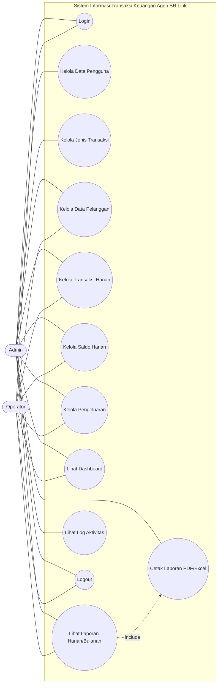
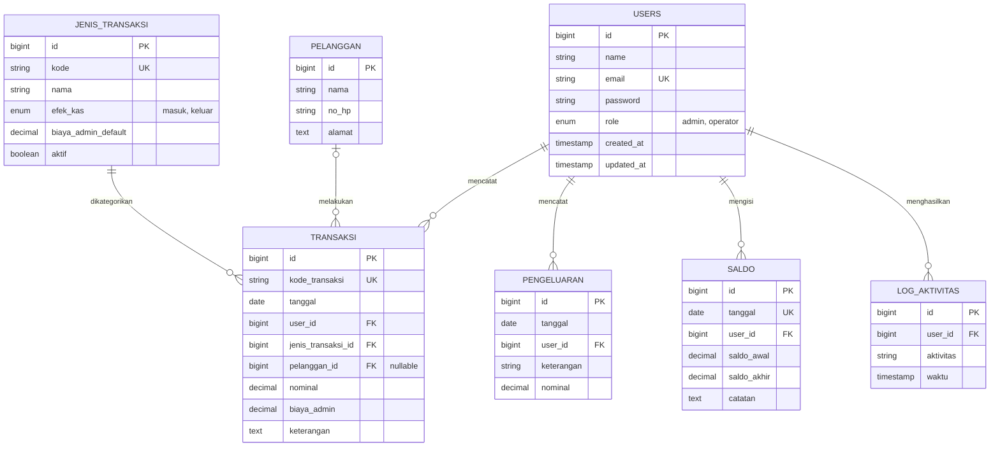

# Perancangan Sistem — Sistem Informasi Pengelolaan Transaksi Keuangan Harian Agen BRILink

Tempel kode Mermaid di https://mermaid.live untuk mengekspor gambar (PNG/SVG) ke dalam skripsi.

## 1. Aktor

| Aktor | Deskripsi |
|---|---|
| Admin | Pemilik/pengelola agen. Mengelola seluruh data, pengguna, dan melihat laporan. |
| Operator | Petugas yang mencatat transaksi harian dan pengeluaran. |

## 2. Use Case Diagram

Versi PlantUML ada di `use-case.puml`.

## 3. Skenario Use Case Utama

### 3.1 Kelola Transaksi Harian

| Item | Keterangan |
|---|---|
| Aktor | Admin, Operator |
| Prasyarat | Aktor sudah login |
| Kondisi akhir | Data transaksi tersimpan dan tampil pada laporan hari tersebut |

| Aksi aktor | Respon sistem |
|---|---|
| 1. Memilih menu Transaksi lalu "Tambah Transaksi" | Menampilkan formulir transaksi |
| 2. Memilih jenis transaksi | Mengisi biaya admin default sesuai jenis |
| 3. Mengisi nominal, pelanggan (opsional), keterangan | Memvalidasi input |
| 4. Menekan "Simpan" | Membuat kode transaksi, menyimpan data, mencatat log aktivitas |
| 5. - | Menampilkan pesan sukses dan daftar transaksi terbaru |

Alur alternatif: input tidak valid (nominal kosong/nol) maka sistem menampilkan pesan kesalahan dan data tidak disimpan.

### 3.2 Lihat dan Cetak Laporan

| Aksi aktor | Respon sistem |
|---|---|
| 1. Memilih menu Laporan, memilih periode harian/bulanan | Menampilkan rekap transaksi per jenis, total nominal, total biaya admin (pendapatan), total pengeluaran, laba bersih |
| 2. Menekan "Cetak PDF" atau "Ekspor Excel" | Membuat berkas dan mengunduhnya |

### 3.3 Kelola Saldo Harian

| Aksi aktor | Respon sistem |
|---|---|
| 1. Mengisi saldo awal hari itu | Menyimpan saldo awal (satu data per tanggal) |
| 2. Di akhir hari mengisi saldo akhir | Menyimpan saldo akhir dan menampilkan selisih terhadap hasil hitung sistem |

## 4. ERD

## 5. Kamus Data Ringkas

| Tabel | Fungsi |
|---|---|
| users | Akun pengguna beserta peran (admin/operator) |
| jenis_transaksi | Master layanan BRILink dan tarif biaya admin standar |
| pelanggan | Data pelanggan (opsional pada transaksi) |
| transaksi | Pencatatan transaksi harian |
| saldo | Saldo awal dan akhir per tanggal |
| pengeluaran | Biaya operasional harian |
| log_aktivitas | Jejak aktivitas pengguna |

## 6. Rumus Laporan

- Pendapatan = jumlah `biaya_admin` seluruh transaksi pada periode
- Laba bersih = Pendapatan − jumlah `pengeluaran` pada periode
- Saldo akhir (hitung sistem) = `saldo_awal` + nominal transaksi ber-`efek_kas` masuk − nominal transaksi ber-`efek_kas` keluar + biaya admin − pengeluaran

Catatan: rumus saldo di atas mengasumsikan saldo yang dilacak adalah uang tunai di laci agen. Jika Anda ingin memisahkan saldo tunai dan saldo rekening/EDC, tambahkan satu kolom saldo lagi pada tabel `saldo`.
